# Lab 5 — Securing a WLAN with WPA2-Enterprise (EAP-TLS & PEAP/MSCHAPv2)

**Course:** Wireless and Mobile Networks Security — USTHB, Faculté d'Informatique
**Author:** Bouikni Lydia Hana
**Topic:** WPA2-Enterprise / IEEE 802.1X with Active Directory, AD CS (PKI) and NPS (RADIUS)

---

## Table of contents

1. [Objectives](#1-objectives)
2. [Lab architecture](#2-lab-architecture)
3. [Technologies and concepts](#3-technologies-and-concepts)
4. [Part 1 — Active Directory (WS-AD)](#4-part-1--active-directory-ws-ad)
5. [Part 2 — Certificate Authority (WS-CA)](#5-part-2--certificate-authority-ws-ca)
6. [Part 3 — NPS / RADIUS (WS-NPS)](#6-part-3--nps--radius-ws-nps)
7. [Part 4 — Authenticator with hostapd (Kali)](#7-part-4--authenticator-with-hostapd-kali)
8. [Part 5 — Windows 10 client](#8-part-5--windows-10-client)
9. [Part 6 — Validation: PEAP/MSCHAPv2](#9-part-6--validation-peapmschapv2)
10. [Part 7 — Validation: EAP-TLS](#10-part-7--validation-eap-tls)
11. [Traffic monitoring (tcpdump / Wireshark)](#11-traffic-monitoring-tcpdump--wireshark)
12. [Troubleshooting log](#12-troubleshooting-log)
13. [EAP-TLS vs PEAP/MSCHAPv2](#13-eap-tls-vs-peapmschapv2)
14. [Security analysis](#14-security-analysis)
15. [Limitations and design notes](#15-limitations-and-design-notes)
16. [Conclusion](#16-conclusion)
17. [Command cheat sheet](#17-command-cheat-sheet)

## Repository layout

```
.
├── README.md                       this report
├── configs/
│   └── hostapd.conf                final authenticator configuration (Kali)
├── scripts/
│   ├── 01-ws-ad-setup.ps1          IP, OU, users, groups on the domain controller
│   ├── 02-ws-nps-setup.ps1         NPS role, firewall, RADIUS client
│   ├── 03-kali-authenticator.sh    hostapd installation and start-up
│   └── 04-win10-trigger-auth.cmd   force a new 802.1X authentication on the client
└── screenshots/                    figures referenced in this report
```

> All passwords and secrets in this repository (`Pass@1234`, `Secret@1234`) are **lab-only values** used in an isolated Host-Only network.

---

## 1. Objectives

- Build a WPA2-Enterprise (802.1X) environment with **each service on its own VM**, as in a real enterprise network.
- Centralise users and groups in **Active Directory**.
- Deploy **AD CS** (an enterprise PKI) to issue the RADIUS server certificate and the user certificates.
- Deploy **NPS** as the RADIUS server, with one network policy per EAP method.
- Validate two authentication methods:
  - **EAP-TLS** — mutual certificate authentication, no password;
  - **PEAP/MSCHAPv2** — a password sent inside a TLS tunnel (the assignment asked for EAP-TTLS; see [§15](#15-limitations-and-design-notes)).
- Observe the authentication exchange (EAPOL and RADIUS) with packet captures and server logs.

## 2. Lab architecture

| VM | Role | IP address | Service |
|---|---|---|---|
| WS-AD | Domain Controller | 192.168.100.10 | Active Directory, DNS — domain `lab.local` |
| WS-CA | Certificate Authority | 192.168.100.20 | Enterprise Root CA `lab-CA`, Web Enrollment |
| WS-NPS | RADIUS server | 192.168.100.30 | NPS, UDP 1812 (auth) / 1813 (accounting) |
| Kali Linux | Authenticator (virtual AP) | 192.168.100.60 | `hostapd` (wired driver) |
| Windows 10 | Supplicant (client) | 192.168.100.50 | 802.1X client (PEAP and EAP-TLS) |

Platform: VMware Workstation, Host-Only network `192.168.100.0/24`. The servers run Windows Server 2012 R2. Kali also has a second NAT adapter so it can download packages.

```
 ┌──────────────────────┐
 │ Windows 10           │  Supplicant
 │ 192.168.100.50       │
 └──────────┬───────────┘
            │ EAPOL (EtherType 0x888E)
            ▼
 ┌──────────────────────┐
 │ Kali / hostapd       │  Authenticator (802.1X port control)
 │ 192.168.100.60       │
 └──────────┬───────────┘
            │ RADIUS, UDP 1812, shared secret
            ▼
 ┌──────────────────────┐      LDAP/Kerberos     ┌──────────────────────┐
 │ WS-NPS               │ ─────────────────────► │ WS-AD                │
 │ 192.168.100.30       │   user & group lookup  │ 192.168.100.10       │
 └──────────┬───────────┘                        └──────────────────────┘
            │ server certificate enrolled from
            ▼
 ┌──────────────────────┐
 │ WS-CA (lab-CA)       │  also issues the student1 user certificate
 │ 192.168.100.20       │
 └──────────────────────┘
```

> Windows 10 never talks to Active Directory directly. It authenticates through Kali (`hostapd`), which relays the EAP exchange to NPS inside RADIUS packets. NPS then validates the user against AD and returns the decision.

### 802.1X roles

| 802.1X role | Machine | What it does |
|---|---|---|
| Supplicant | Windows 10 | Holds the credentials (password or certificate) and speaks EAP |
| Authenticator | Kali / `hostapd` | Keeps the port closed, relays EAP between EAPOL and RADIUS, opens the port on `Access-Accept` |
| Authentication server | WS-NPS | Runs the EAP method, checks the identity in AD, applies network policies |

**Why `hostapd` in wired mode?** VMware virtual NICs do not expose a Wi-Fi (`nl80211`) interface, so `hostapd` cannot act as a radio access point. With `driver=wired`, `hostapd` behaves as an 802.1X authenticator on an Ethernet port. The authentication logic (EAPOL → RADIUS → NPS → AD) is the same as on a real WPA2-Enterprise access point; only the radio part (association, 4-way handshake, CCMP encryption) is missing.

## 3. Technologies and concepts

| Element | Role in the lab |
|---|---|
| IEEE 802.1X | Port-based network access control (supplicant / authenticator / authentication server) |
| EAP (RFC 3748) | Generic authentication framework carrying the actual method (TLS, PEAP, …) |
| EAPOL | Encapsulation of EAP directly over Ethernet/802.11 between client and authenticator |
| RADIUS (RFC 2865) | Transport between the authenticator and the authentication server; EAP is carried in the `EAP-Message` attribute and protected by `Message-Authenticator` |
| PEAP (MSCHAPv2) | Phase 1: TLS tunnel authenticated by the server certificate. Phase 2: MSCHAPv2 password authentication inside the tunnel |
| EAP-TLS (RFC 5216) | Mutual X.509 certificate authentication; no password |
| AD DS | Identity store (users, groups, `WLANUsers`) |
| AD CS | PKI that issues the NPS server certificate and the student user certificates |
| NPS | Microsoft RADIUS server: policy engine that decides on access (conditions, constraints, authentication methods) |

### How WPA2-Enterprise uses 802.1X

In WPA2-Personal every client shares the same passphrase (PSK). In WPA2-Enterprise each user authenticates individually through 802.1X. When EAP succeeds, both the client and the RADIUS server derive a **PMK** (Pairwise Master Key) from the TLS session; NPS sends it to the access point in the `MS-MPPE-Recv-Key`/`MS-MPPE-Send-Key` attributes of the `Access-Accept`. On a real AP the PMK is then used in the 4-way handshake to derive the per-session encryption keys. Each user therefore gets unique keys, and revoking one account does not require changing a shared passphrase.

### Authentication sequence (generic)

```
Supplicant            Authenticator (hostapd)         NPS                     AD
    │── EAPOL-Start ──────►│                              │                     │
    │◄── EAP-Req/Identity ─│                              │                     │
    │── EAP-Resp/Identity ►│── Access-Request ───────────►│                     │
    │                      │◄── Access-Challenge ─────────│ (EAP-Req: PEAP/TLS) │
    │◄── EAP-Request ──────│                              │                     │
    │        ... TLS handshake, several round trips ...   │                     │
    │── EAP-Response ─────►│── Access-Request ───────────►│── user/group ──────►│
    │                      │                              │◄── OK ──────────────│
    │                      │◄── Access-Accept (+ keys) ───│                     │
    │◄── EAP-Success ──────│  port authorised             │                     │
```

---

## 4. Part 1 — Active Directory (WS-AD)

### 4.1 Network and name

Run PowerShell **as Administrator** (otherwise `New-NetIPAddress` fails with *Access is denied*):

```powershell
New-NetIPAddress -InterfaceAlias "Ethernet0" -IPAddress 192.168.100.10 -PrefixLength 24
Set-DnsClientServerAddress -InterfaceAlias "Ethernet0" -ServerAddresses 192.168.100.10
Rename-Computer -NewName "WS-AD" -Restart
```

The DC points to itself for DNS because it will host the `lab.local` DNS zone. Every other server uses `192.168.100.10` as its DNS server, which is what allows them to locate the domain when joining it.

### 4.2 Domain controller promotion

Install **Active Directory Domain Services** with Server Manager, then click *Promote this server to a domain controller* and create the domain `lab.local`. The wizard was used instead of `Install-ADDSForest`, whose parameters were not accepted on this 2012 R2 installation (see [§12](#12-troubleshooting-log)).

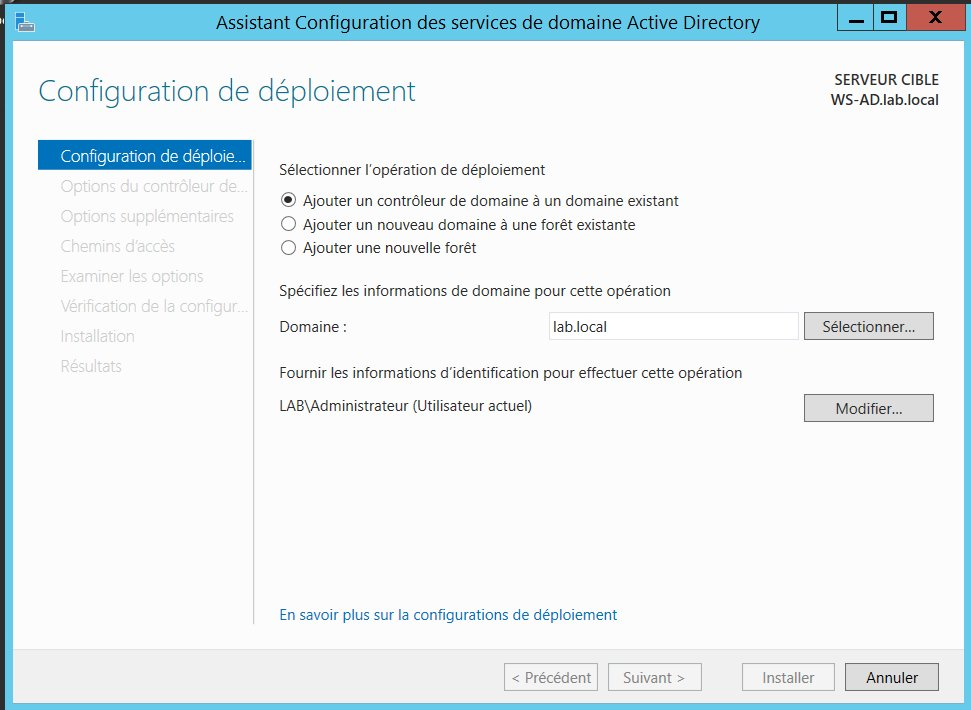

**Fig. 1** — AD DS configuration wizard on `WS-AD.lab.local`: domain `lab.local`, operation run as `LAB\Administrateur`.

### 4.3 OU, users and group

```powershell
New-ADOrganizationalUnit -Name "Etudiants" -Path "DC=lab,DC=local"

New-ADUser -Name "student1" -SamAccountName "student1" -UserPrincipalName "student1@lab.local" `
  -Path "OU=Etudiants,DC=lab,DC=local" `
  -AccountPassword (ConvertTo-SecureString "Pass@1234" -AsPlainText -Force) -Enabled $true
New-ADUser -Name "student2" -SamAccountName "student2" -UserPrincipalName "student2@lab.local" `
  -Path "OU=Etudiants,DC=lab,DC=local" `
  -AccountPassword (ConvertTo-SecureString "Pass@1234" -AsPlainText -Force) -Enabled $true

New-ADGroup -Name "WLANUsers" -GroupScope Global -Path "OU=Etudiants,DC=lab,DC=local"
Add-ADGroupMember -Identity "WLANUsers" -Members "student1","student2"
```

The `WLANUsers` group is the authorisation criterion: NPS policies grant access to members of this group only. Adding or removing a user from the group is enough to give or remove Wi-Fi access, without touching the access point or NPS.

### 4.4 Verification

```powershell
Get-ADUser -Filter * -SearchBase "OU=Etudiants,DC=lab,DC=local" | Select Name, Enabled
net group WLANUsers /domain
```

Both users must appear as `Enabled = True` and be listed as members of `WLANUsers`.

The full sequence is in [`scripts/01-ws-ad-setup.ps1`](scripts/01-ws-ad-setup.ps1).

## 5. Part 2 — Certificate Authority (WS-CA)

### 5.1 Prepare the server

1. Static IP `192.168.100.20`, DNS `192.168.100.10`.
2. Rename and join `lab.local`:

```powershell
Rename-Computer -NewName "WS-CA" -Restart
control sysdm.cpl        # Change > Domain > lab.local
```

3. Log in with a **domain** account (`LAB\Administrateur`). With a local account the *Enterprise CA* option is greyed out, because an Enterprise CA must publish itself and its templates in Active Directory.

### 5.2 Install AD CS

Server Manager → Add Roles and Features → **Active Directory Certificate Services**, with the role services:

- *Certification Authority*
- *Certification Authority Web Enrollment* (gives `http://192.168.100.20/certsrv`, used later by the client)

### 5.3 Configure the CA

| Step | Choice | Reason |
|---|---|---|
| Setup type | **Enterprise CA** | Integrated with AD: certificate templates (*Computer*, *User*) and auto-trust for domain members |
| CA type | **Root CA** | First and only CA of the lab |
| Private key | Create a new private key | |
| CA name | `lab-CA` | Short name, easy to recognise on the client |
| Validity | 5 years | |

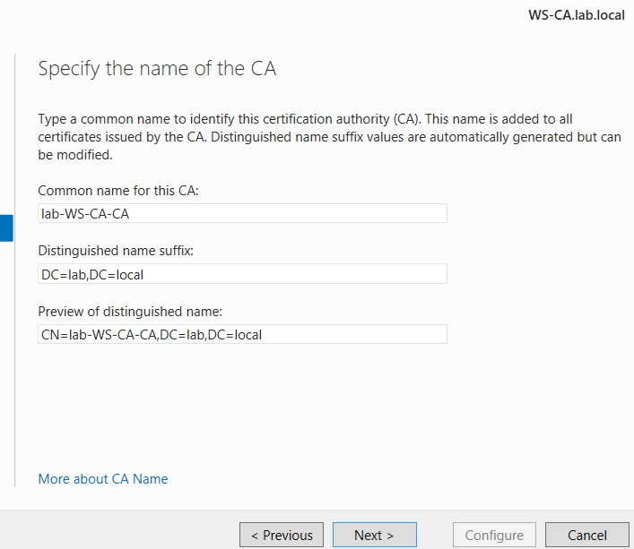

**Fig. 2** — AD CS configuration on `WS-CA.lab.local`, *Specify the name of the CA* step. The wizard proposes `lab-WS-CA-CA` by default; the common name was set to `lab-CA`.

Verify that the CA answers:

```powershell
certutil -ping
certutil -catemplates     # lists the templates available (Computer, User, ...)
```

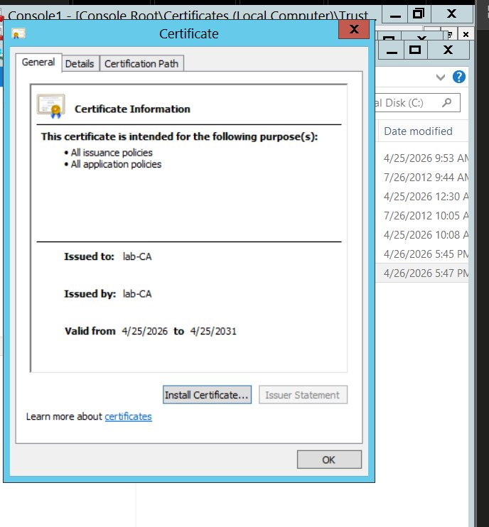

**Fig. 3** — Root certificate `lab-CA` (self-signed: *Issued to* = *Issued by*), valid from 25/04/2026 to 25/04/2031.

### 5.4 Export the root certificate

The client is not a domain member (see [§8](#8-part-5--windows-10-client)), so it does not receive `lab-CA` automatically through Group Policy. The certificate must be exported and installed manually:

MMC → Certificates (Local Computer) → Trusted Root Certification Authorities → `lab-CA` → All Tasks → Export → **DER encoded binary X.509** → `lab-CA.cer`, placed in a shared folder `CertShare`.

Only the **public** certificate is exported, never the CA private key.

## 6. Part 3 — NPS / RADIUS (WS-NPS)

### 6.1 Installation and domain join

```powershell
Rename-Computer -NewName "WS-NPS" -Restart
control sysdm.cpl        # join lab.local
Install-WindowsFeature -Name NPAS -IncludeManagementTools
netsh nps add registeredserver domain=lab.local server=WS-NPS.lab.local
```

The GUI installation failed with `0x800f0922`; installing the role from PowerShell as above worked.

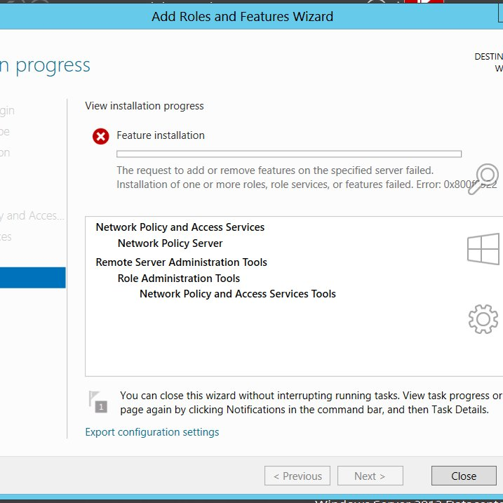

**Fig. 4** — NPS role installation failing in the Add Roles and Features wizard (`0x800f0922`).

`netsh nps add registeredserver` registers NPS in AD, i.e. adds its computer account to the *RAS and IAS Servers* group so that it can read the dial-in properties of user accounts (see [§6.6](#66-ad-group-required-by-nps)).

### 6.2 Server certificate for PEAP

Both PEAP and EAP-TLS start with a TLS handshake in which **the server must present a certificate**. Without it, NPS refuses to configure PEAP:

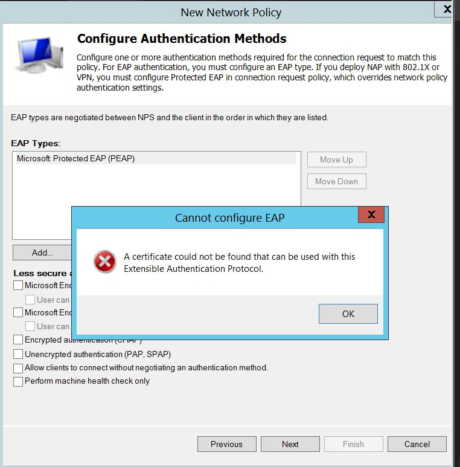

**Fig. 5** — *"A certificate could not be found that can be used with this Extensible Authentication Protocol"* while adding PEAP to a policy.

Request one from `lab-CA`:

MMC → Certificates (Local Computer) → Personal → right-click → All Tasks → *Request New Certificate* → Active Directory Enrollment Policy → template **Computer** → Enroll.

Result: certificate `WS-NPS.lab.local`, issued by `lab-CA`, with the *Server Authentication* EKU (OID `1.3.6.1.5.5.7.3.1`) required for an EAP server certificate.

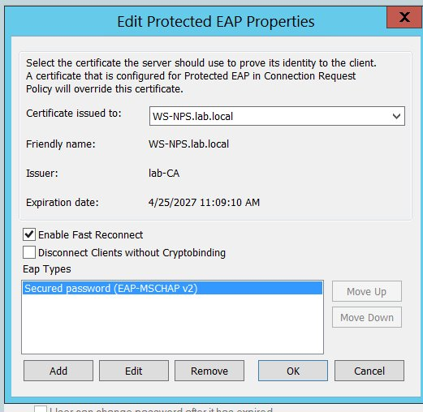

**Fig. 6** — PEAP properties in NPS: server certificate `WS-NPS.lab.local` issued by `lab-CA` (expires 25/04/2027), inner method *Secured password (EAP-MSCHAP v2)*, Fast Reconnect enabled.

### 6.3 RADIUS client

The RADIUS client is the authenticator (Kali), not the Windows 10 machine.

NPS console → RADIUS Clients and Servers → RADIUS Clients → New:

| Field | Value |
|---|---|
| Friendly name | `AP-Kali` |
| Address | `192.168.100.60` |
| Shared secret | `Secret@1234` |

The shared secret is used to sign RADIUS packets (`Response Authenticator`, `Message-Authenticator`) and to encrypt the keys sent back to the authenticator. It must be **identical** in `hostapd.conf`. NPS also drops requests coming from an IP address that is not declared as a client, so the address must be the one Kali actually uses on the Host-Only network.

Equivalent command line:

```cmd
netsh nps add client name="AP-Kali" address="192.168.100.60" state=enable sharedsecret="Secret@1234"
```

### 6.4 Network policies

A network policy has three parts: **conditions** (who/what the request must match), **constraints** (authentication methods, timeouts…) and **settings** (attributes returned in `Access-Accept`).

| Order | Policy | Conditions | Authentication method |
|---|---|---|---|
| 1 | `EAP-TTLS-Policy` (PEAP) | User group `LAB\WLANUsers`, NAS-Port-Type *Wireless – IEEE 802.11* | Microsoft: Protected EAP (PEAP) → Secured password (EAP-MSCHAP v2), certificate `WS-NPS.lab.local` |
| 2 | `EAP-TLS-Policy` | User group `LAB\WLANUsers`, NAS-Port-Type *Wireless – IEEE 802.11* | Microsoft: Smart Card or other certificate |

The policy names come from the assignment; `EAP-TTLS-Policy` actually uses PEAP (see [§15](#15-limitations-and-design-notes)).

For each policy: *Access granted*, and all *less secure methods* (MS-CHAP, MS-CHAPv2, CHAP, PAP, unauthenticated access) unchecked, so that only the EAP method of the policy can be used.

| | |
|---|---|
| 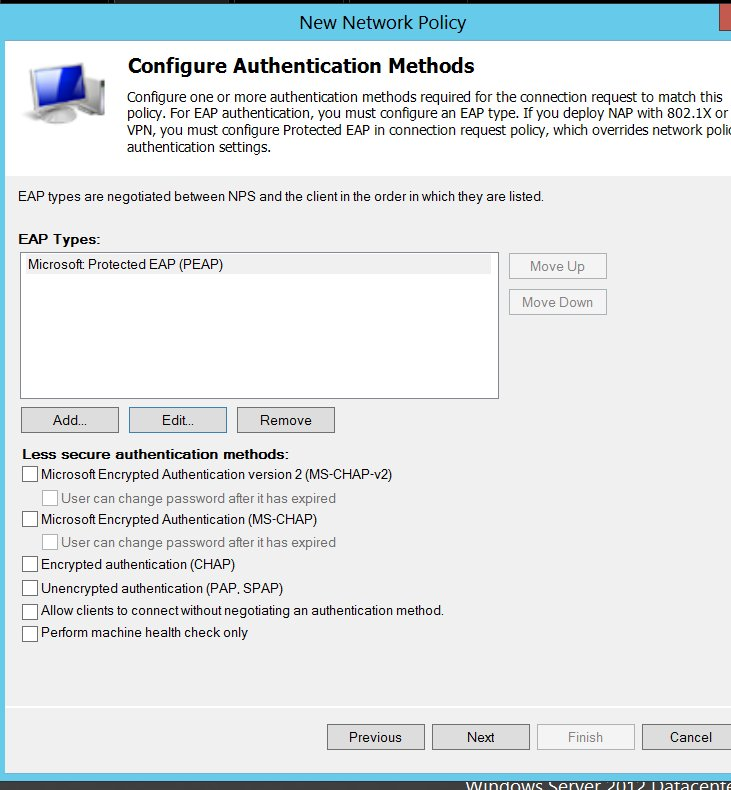 | 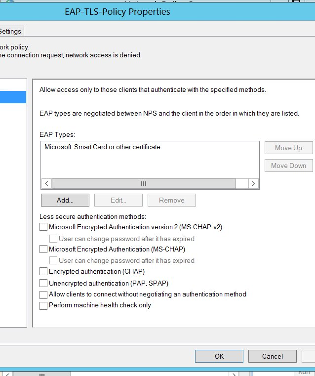 |
| **Fig. 7** — `EAP-TTLS-Policy`: Protected EAP (PEAP) only, less secure methods unchecked | **Fig. 8** — `EAP-TLS-Policy`: Smart Card or other certificate only |

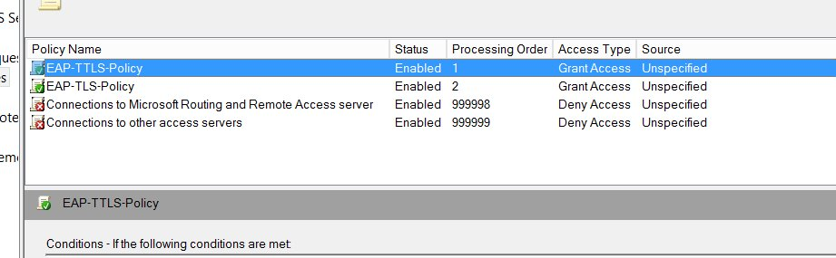

**Fig. 9** — Network policy processing order: `EAP-TTLS-Policy` = 1, `EAP-TLS-Policy` = 2, followed by the two default *Deny Access* policies.

**Why the order matters.** NPS evaluates policies by processing order and uses the **first policy whose conditions match**. Both policies have the same conditions (group + port type), so every request matches policy 1 first. If the client then proposes an EAP type that policy 1 does not allow, NPS rejects the request (event 6273, reason *"the authentication method is not allowed"*) instead of falling through to policy 2. In practice this means:

- with identical conditions, put the policy of the method you are testing first; or
- differentiate the policies with a condition that distinguishes them (e.g. a different user group, or an *Authentication Type / EAP type* condition) so each request reaches the right one.

**NAS-Port-Type.** The first version of the policies matched *Ethernet*. The NPS logs showed that `hostapd` sends *Wireless – IEEE 802.11* (value 19), so the condition was changed to match what NPS actually receives.

### 6.5 Firewall and service

```powershell
New-NetFirewallRule -DisplayName "Allow RADIUS 1812" -Direction Inbound -Protocol UDP -LocalPort 1812 -Action Allow
New-NetFirewallRule -DisplayName "Allow RADIUS 1813" -Direction Inbound -Protocol UDP -LocalPort 1813 -Action Allow
netstat -ano | findstr :1812
net stop ias
net start ias
```

`netstat` must show NPS listening on `0.0.0.0:1812`. The NPS service is still called `ias` (Internet Authentication Service, its name before Windows Server 2008).

### 6.6 AD group required by NPS

NPS must be allowed to read user accounts in AD. On this domain the group *RAS and IAS Servers* did not exist, and NPS logged *"The specified user account does not exist"* even though `student1` existed. Creating the group and adding the NPS computer account fixed it:

```powershell
New-ADGroup -Name "RAS and IAS Servers" -GroupScope DomainLocal -Path "CN=Users,DC=lab,DC=local"
Add-ADGroupMember -Identity "RAS and IAS Servers" -Members "WS-NPS$"
```

`WS-NPS$` is the computer account of the NPS server. Restart NPS (or the server) afterwards so that it obtains a new Kerberos ticket with the new group membership.

### 6.7 NPS audit events

| Event ID | Meaning |
|---|---|
| **6272** | Network Policy Server **granted access** to a user |
| **6273** | Network Policy Server **denied access** to a user (the *Reason Code* and *Reason* fields explain why) |
| 6274 | NPS discarded the request (malformed / unknown client) |
| 6278 | NPS granted full access because the host met the health policy (logged together with 6272) |

If these events do not appear, enable auditing: `auditpol /set /subcategory:"Network Policy Server" /success:enable /failure:enable`.

The scripted version of this part is in [`scripts/02-ws-nps-setup.ps1`](scripts/02-ws-nps-setup.ps1).

## 7. Part 4 — Authenticator with hostapd (Kali)

```bash
sudo apt update && sudo apt install hostapd -y
sudo nano /etc/hostapd/hostapd.conf
```

Final configuration ([`configs/hostapd.conf`](configs/hostapd.conf)):

```ini
interface=eth0
driver=wired

ieee8021x=1
eapol_version=1
eap_server=0

own_ip_addr=192.168.100.60

auth_server_addr=192.168.100.30
auth_server_port=1812
auth_server_shared_secret=Secret@1234

logger_stdout=-1
logger_stdout_level=0
logger_syslog=-1
logger_syslog_level=0
```

| Directive | Meaning |
|---|---|
| `interface=eth0` | Interface on the Host-Only network, facing the client |
| `driver=wired` | 802.1X on an Ethernet port (no Wi-Fi hardware in the VM) |
| `ieee8021x=1` | Enable 802.1X port control |
| `eapol_version=1` | EAPOL version 1, the most compatible with the Windows supplicant |
| `eap_server=0` | Do not authenticate locally; forward everything to RADIUS |
| `own_ip_addr` | `NAS-IP-Address` sent in RADIUS requests |
| `auth_server_*` | NPS address, port and **shared secret** (must match the RADIUS client in NPS) |
| `logger_*` | Log every module at the most verbose level |

Run it in debug mode:

```bash
sudo pkill hostapd
sudo hostapd -dd /etc/hostapd/hostapd.conf
```

Expected start-up output: `RADIUS Authentication server 192.168.100.30:1812` and `eth0: AP-ENABLED`.

Network checks from Kali:

```bash
ip a                       # eth0 has 192.168.100.60
ip route                   # 192.168.100.0/24 via eth0
ping -c 4 192.168.100.30   # NPS reachable
```

What to look for in the `hostapd -dd` output during an authentication:

| Log line | Meaning |
|---|---|
| `IEEE 802.1X: received EAPOL-Start` | The client started 802.1X |
| `Sending RADIUS message to authentication server` | `Access-Request` sent to NPS |
| `Received RADIUS message ... Access-Challenge` | NPS continues the EAP method |
| `Received RADIUS message ... Access-Accept` | NPS accepted the user |
| `CTRL-EVENT-EAP-SUCCESS2`, `AUTHENTICATED`, `authorizing port` | Port opened for the client |
| `Received RADIUS message ... Access-Reject` | NPS refused — check event 6273 on WS-NPS |
| `EAP-TIMEOUT-FAILURE` / no reply from server | RADIUS replies not received (secret, IP, firewall) |

## 8. Part 5 — Windows 10 client

The Windows 10 VM is the **Home** edition, which cannot join a domain:

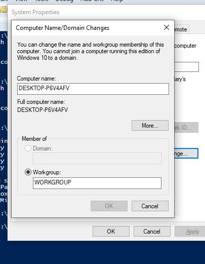

**Fig. 10** — *"You cannot join a computer running this edition of Windows 10 to a domain"*.

This is not a problem for 802.1X: the client does not need to be a domain member. It only needs the user credentials (or certificate) and to trust `lab-CA`. The difference is that nothing is pushed by Group Policy: CA trust, the 802.1X profile and the user certificate are configured manually.

### 8.1 Trust the CA

The `lab-CA.cer` file was copied from WS-CA to Kali with `smbclient`, then served to Windows 10 over HTTP:

```bash
smbclient //192.168.100.20/CertShare -U "LAB\Administrateur" -c "get lab-CA.cer /tmp/lab-CA.cer"
cd /tmp && python3 -m http.server 8080
```

On Windows 10, download `http://192.168.100.60:8080/lab-CA.cer`, then import it in the machine **Trusted Root** store (elevated prompt):

```powershell
certutil -addstore "Root" "C:\Users\<user>\Downloads\lab-CA.cer"
```

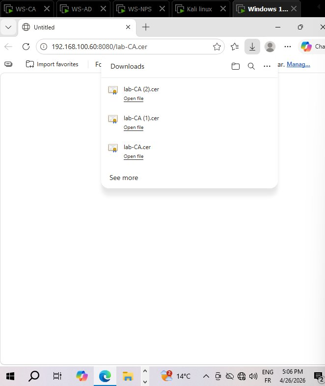

**Fig. 11** — `lab-CA.cer` downloaded on Windows 10 from the Kali HTTP server (`192.168.100.60:8080`).

Without this step the client cannot validate the `WS-NPS.lab.local` certificate and stops the TLS handshake (or warns the user, depending on the profile).

### 8.2 Enable wired 802.1X

On Windows the wired 802.1X supplicant is the **Wired AutoConfig** service (`dot3svc`). It is stopped by default, and the *Authentication* tab of the network adapter only appears when it runs.

```powershell
Start-Service dot3svc
Set-Service dot3svc -StartupType Automatic
ncpa.cpl
```

Ethernet0 → Properties → Authentication → *Enable IEEE 802.1X authentication*.

## 9. Part 6 — Validation: PEAP/MSCHAPv2

### 9.1 Client configuration

Ethernet0 → Properties → Authentication:

- Network authentication method: **Microsoft: Protected EAP (PEAP)**
- Settings:
  - *Verify the server's identity by validating the certificate* — checked
  - Trusted Root Certification Authorities: **`lab-CA`** checked
  - Authentication method: **Secured password (EAP-MSCHAP v2)** → Configure → uncheck *Automatically use my Windows logon name and password* (the local Windows account is not a domain account)
- Additional settings: *User authentication*, *Replace credentials* → `student1` / `Pass@1234`

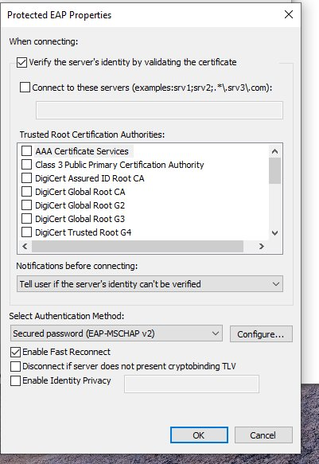

**Fig. 12** — Protected EAP properties on the client: server certificate validation enabled, inner method EAP-MSCHAP v2.

Optionally, fill *Connect to these servers* with `WS-NPS.lab.local`: the client then also checks the name in the server certificate, not only the issuing CA.

### 9.2 Trigger a new authentication

```cmd
net stop dot3svc
net start dot3svc
netsh interface set interface "Ethernet0" admin=disable
netsh interface set interface "Ethernet0" admin=enable
netsh lan show interfaces
```

(also available as [`scripts/04-win10-trigger-auth.cmd`](scripts/04-win10-trigger-auth.cmd))

Expected:

```
State : Connected. Authentication succeeded.
```

### 9.3 Evidence on the other machines

- **`hostapd`**: `EAP Success`, `CTRL-EVENT-EAP-SUCCESS2`, `AUTHENTICATED`, `authorizing port`.
- **NPS**: Event Viewer → Windows Logs → Security (or Custom Views → Server Roles → Network Policy and Access Services): event **6272** *Network Policy Server granted access to a user*, with `Network Policy Name: EAP-TTLS-Policy` and `Authentication Type: PEAP`.

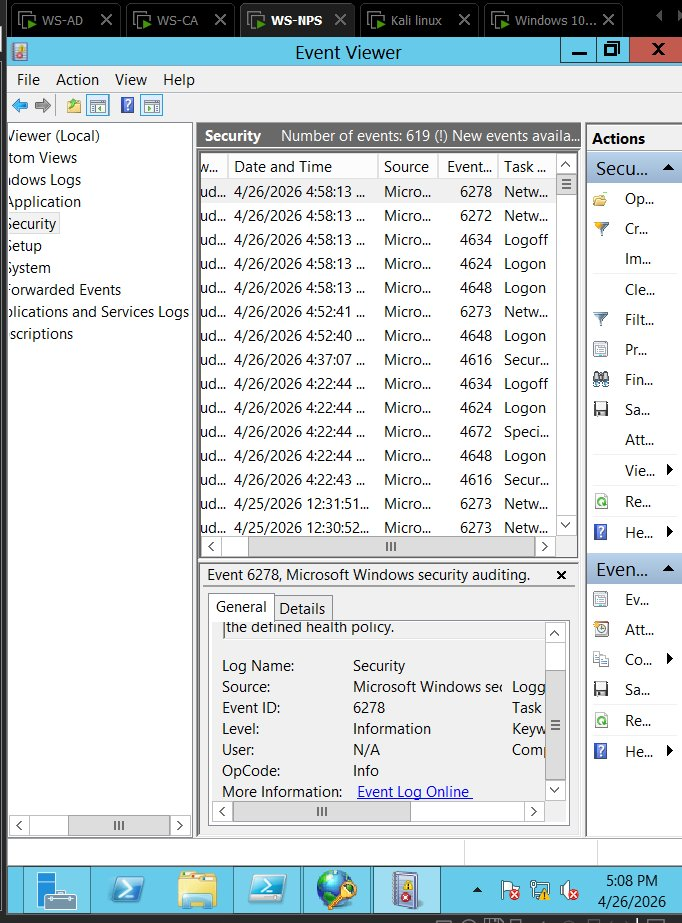

**Fig. 13** — Security log on `WS-NPS`: events 6272/6278 (access granted) and 6273 (access denied) recorded during the tests.

### 9.4 What happens

1. The client sends `EAPOL-Start`; `hostapd` answers `EAP-Request/Identity`.
2. The client answers with its identity (`student1`); `hostapd` encapsulates it in a RADIUS `Access-Request`.
3. NPS matches `EAP-TTLS-Policy` and proposes PEAP in an `Access-Challenge`.
4. **Phase 1 — TLS tunnel.** NPS sends the `WS-NPS.lab.local` certificate; the client checks that it chains to `lab-CA`. A TLS session is established. Only the server is authenticated at this point.
5. **Phase 2 — MSCHAPv2 inside the tunnel.** The client proves knowledge of the password with a challenge-response; NPS checks it against AD. The server also proves it knows the password (MSCHAPv2 is mutual).
6. NPS sends `Access-Accept` with the keying material; `hostapd` sends `EAP-Success` to the client and authorises the port.

## 10. Part 7 — Validation: EAP-TLS

### 10.1 User certificate for student1

In EAP-TLS the client proves its identity with a certificate and its private key, so `student1` needs a **User** certificate from `lab-CA`.

Because the client is not a domain member, the certificate is requested through **web enrollment**: `http://192.168.100.20/certsrv` → *Request a certificate* → *User Certificate* (authenticate as `LAB\student1`) → Submit → *Install this certificate*. The key pair is generated on the client, so the private key never leaves it.

In `certmgr.msc` → Current User → Personal → Certificates, verify:

- Issued to: `student1`
- Issued by: `lab-CA`
- *You have a private key that corresponds to this certificate*
- Intended purposes include **Client Authentication** (OID `1.3.6.1.5.5.7.3.2`)

Also verify that `lab-CA` is present in *Trusted Root Certification Authorities*.

NPS maps the certificate to the AD account `student1` using the UPN / subject of the certificate, then checks group membership (`WLANUsers`) as for PEAP.

### 10.2 NPS

Check `EAP-TLS-Policy` (conditions and *Smart Card or other certificate*, using the `WS-NPS.lab.local` server certificate), make sure it is reachable given the processing order (see [§6.4](#64-network-policies)), then restart NPS:

```powershell
net stop ias
net start ias
```

### 10.3 Client configuration

Ethernet0 → Authentication → **Microsoft: Smart Card or other certificate** → Settings:

- *Use a certificate on this computer*
- *Use simple certificate selection*
- *Verify the server's identity by validating the certificate*, trusted root **`lab-CA`**

Additional settings → *User authentication*.

### 10.4 Test

```bash
# Kali — terminal 1
sudo pkill hostapd
sudo hostapd -dd /etc/hostapd/hostapd.conf

# Kali — terminal 2
sudo tcpdump -ni eth0 host 192.168.100.30 and udp port 1812
```

```cmd
:: Windows 10
net stop dot3svc
net start dot3svc
netsh interface set interface "Ethernet0" admin=disable
netsh interface set interface "Ethernet0" admin=enable
netsh lan show interfaces
```

Expected: `State : Connected. Authentication succeeded.`

NPS event **6272** shows `Network Policy Name: EAP-TLS-Policy` and `Authentication Type: EAP` (EAP type *Microsoft: Smart Card or other certificate*).

### 10.5 What happens

1. Identity exchange as in PEAP.
2. NPS proposes EAP-TLS (EAP type 13).
3. TLS handshake: NPS sends its certificate **and a `CertificateRequest`**; the client validates the server certificate and sends the `student1` certificate, then a `CertificateVerify` signed with its private key.
4. NPS checks that the client certificate chains to `lab-CA`, is valid and not revoked (CRL published by the CA), and maps it to the AD account.
5. `Access-Accept` → `EAP-Success` → port authorised.

No password is ever transmitted, even encrypted.

## 11. Traffic monitoring (tcpdump / Wireshark)

```bash
# Client <-> authenticator (EAPOL)
sudo tcpdump -ni eth0 ether proto 0x888e -vv

# Authenticator <-> NPS (RADIUS)
sudo tcpdump -ni eth0 host 192.168.100.30 and udp port 1812

# Save for Wireshark
sudo tcpdump -ni eth0 '(ether proto 0x888e) or (udp port 1812)' -w lab5-8021x.pcap
```

| Capture | What to look for |
|---|---|
| EAPOL (`0x888e`) | EAPOL-Start, EAP Request/Response Identity, EAP-PEAP / EAP-TLS fragments, EAP-Success / Failure |
| RADIUS (UDP 1812) | Access-Request, Access-Challenge (several), **Access-Accept** / Access-Reject |

**How to read it.** If the `EAP Response Identity` never appears, the problem is on the Windows client (service, profile, cable/interface). If it appears but there is no `Access-Accept`, the problem is on the NPS side (policy, secret, certificate, user lookup). If `Access-Request` packets leave Kali but no answer comes back, look at the RADIUS client definition, the firewall and the shared secret.

**In Wireshark** (filters `eapol` and `radius`):

- **EAP-TLS**: the TLS handshake is in clear text inside the EAP messages; both certificates are visible (`WS-NPS.lab.local` and `student1`).
- **PEAP**: only the server certificate is visible; after the handshake, the inner MSCHAPv2 exchange appears as encrypted *Application Data*.
- **RADIUS**: in `Access-Accept`, the `MS-MPPE-*-Key` attributes are present but encrypted with the shared secret. With the secret configured in Wireshark (*Protocols → RADIUS → Shared Secret*), the RADIUS attributes can be decoded.

## 12. Troubleshooting log

| Symptom | Cause | Fix |
|---|---|---|
| `New-NetIPAddress: Access is denied` | PowerShell not elevated | Run as Administrator |
| `Install-ADDSForest` argument not recognised | Parameters mangled when pasted; module quirks on 2012 | Promote the server with the Server Manager wizard |
| Domain join fails ("user name or password incorrect") | VM clone/rename confusion: the machine had the wrong hostname | Fix hostnames (`hostname`, `Rename-Computer`), then join through `control sysdm.cpl` |
| *Enterprise CA* greyed out | Logged on with a local account | Log in as `LAB\Administrateur` |
| `Install-AdcsCertificationAuthority` fails (`0x80072082`) | Command-line parameters rejected on 2012 | Configure AD CS through the GUI wizard |
| NPS role install fails (`0x800f0922`) | Feature install via GUI | `Install-WindowsFeature -Name NPAS -IncludeManagementTools` |
| *"A certificate could not be found"* when editing PEAP | NPS has no server certificate | Request a *Computer* certificate from `lab-CA` |
| `hostapd`: `nl80211 driver initialization failed` | VM NIC is not a Wi-Fi device | Use `driver=wired` |
| Policy never matched | Condition NAS-Port-Type = *Ethernet*, but `hostapd` sends *Wireless – IEEE 802.11* | Match the NAS-Port-Type actually received (seen in the NPS logs) |
| EAP rejected: wrong method proposed (TLS/PEAP) | Policy order and client EAP type | Reorder policies; configure the client with the matching method |
| Event 6273: *"The specified user account does not exist"* | NPS could not read AD accounts | Create *RAS and IAS Servers* group and add `WS-NPS$` |
| Event 6273: *"The signature was not verified"* | Shared secret mismatch between `hostapd` and NPS | Align the secret on both sides |
| `EAP-TIMEOUT-FAILURE` | RADIUS replies not reaching `hostapd` (network, firewall, secret) | Check connectivity, firewall rules, and that `AP-Kali` uses the real source IP |
| `lab-CA.cer` not found by PowerShell | File saved as `lab-CA.cer .cer` | `Rename-Item "C:\lab-CA.cer .cer" "C:\lab-CA.cer"` |
| `smbclient` session setup failed | Wrong domain context | Use `-U "LAB\Administrateur"` |
| Kali has no Internet in Host-Only | Host-Only has no NAT | Add a second NAT adapter to Kali |

**Method used.** Each failure was located by following the chain hop by hop: client (`netsh lan show interfaces`) → authenticator (`hostapd -dd`) → network (`tcpdump`) → RADIUS server (event 6273 *Reason Code*). The NPS reason code was the most useful piece of information: it names the exact cause (unknown user, wrong secret, method not allowed, no matching policy).

## 13. EAP-TLS vs PEAP/MSCHAPv2

| Criterion | EAP-TLS | PEAP/MSCHAPv2 |
|---|---|---|
| Client authentication | X.509 client certificate + private key | Username and password |
| Server authentication | X.509 certificate | X.509 certificate |
| Mutual authentication | Yes, both by certificate | Yes (server by certificate, client by password) |
| Credential exposed to guessing | None (private key stays on the client) | Password (offline attack if the tunnel is bypassed, e.g. evil-twin with a lax client) |
| Deployment effort | High (PKI, enrolment of every user/device, revocation) | Medium (only a server certificate) |
| Protection against credential phishing | Strong | Weak if clients do not validate the server certificate |
| User experience | Transparent once the certificate is installed | User must type / store a password |
| NPS policy in this lab | `EAP-TLS-Policy` | `EAP-TTLS-Policy` (PEAP) |
| EAP type | 13 | 25 |

## 14. Security analysis

- **Server certificate validation is the key setting of PEAP.** If the client does not check the server certificate (or accepts any CA), an attacker can set up a rogue AP with its own RADIUS server (evil twin), terminate the TLS tunnel and capture the MSCHAPv2 challenge-response. MSCHAPv2 is based on DES and can be cracked offline, revealing the user password. In this lab the client validates the certificate and trusts only `lab-CA`; pinning the server name (`WS-NPS.lab.local`) closes the gap further.
- **EAP-TLS removes the password.** A rogue server cannot obtain anything reusable: the client certificate is public, and the private key is never sent. The cost is managing a PKI: issuing, renewing and **revoking** certificates (the CRL of `lab-CA` must be reachable by NPS).
- **Shared secret.** The RADIUS secret protects the integrity of RADIUS packets and the keys sent to the AP. It must be long and random in production, and unique per AP.
- **Least privilege in policies.** Only members of `WLANUsers` are granted access, and the *less secure methods* (PAP, CHAP, MS-CHAP) are disabled, so a downgrade to a weaker method is impossible.
- **Identity privacy.** The outer identity (`EAP-Response/Identity`) is sent in clear text. PEAP's *Enable Identity Privacy* option can replace it with an anonymous identity; the real one is then only sent inside the tunnel.

## 15. Limitations and design notes

- **EAP-TTLS vs PEAP.** The assignment asks for EAP-TTLS with a password inside a TLS tunnel. The NPS role on Windows Server 2012 R2 has no native EAP-TTLS support: it offers **PEAP**. When `eapol_test` on Kali proposed TTLS, NPS answered with PEAP (EAP type 25) and rejected the TTLS client. The password-in-TLS-tunnel scenario was therefore demonstrated with **PEAP/MSCHAPv2**, which uses the same tunnelled-credential principle. A real TTLS deployment would use FreeRADIUS, or a third-party TTLS plugin on NPS. The policy kept its original name `EAP-TTLS-Policy`.
- **Virtual access point.** `hostapd` with the wired driver replaces a Wi-Fi AP. The 802.1X and RADIUS logic is the same, but association, the 4-way handshake and WPA2 over-the-air encryption (CCMP/AES) are not exercised.
- **Client outside the domain.** Windows 10 Home cannot join the domain, so CA trust, the 802.1X profile and the user certificate were configured by hand. In an enterprise these would be deployed by Group Policy (wired/wireless network policies and certificate auto-enrolment).
- **Identities.** The student passwords and the RADIUS secret are lab values and must not be reused anywhere else.
- **Firewall.** During troubleshooting the Windows firewall was disabled on some servers. In production, keep it enabled and open only UDP 1812/1813 on the NPS server.

## 16. Conclusion

A complete 802.1X chain was deployed with each service on a separate VM: Active Directory for identities, AD CS for certificates, NPS as RADIUS server, and `hostapd` on Kali as authenticator. A Windows 10 client was authenticated with **PEAP/MSCHAPv2** (password inside a TLS tunnel) and with **EAP-TLS** (client certificate issued by `lab-CA`). Both were checked from three viewpoints: the client (`netsh lan show interfaces`), the authenticator (`hostapd` logs), and the RADIUS server (NPS event 6272 and packet captures).

Most of the work was not in the configuration itself but in making the components agree with each other: the same shared secret on both RADIUS ends, the NAS-Port-Type actually sent by the authenticator, the policy order, the NPS permissions in AD, and a CA trusted by both sides. EAP-TLS removes password exposure at the cost of a PKI; PEAP is simpler to deploy but its security depends on clients strictly validating the server certificate.

## 17. Command cheat sheet

**Kali**

```bash
ip a
ip route
ping -c 4 192.168.100.30
sudo nano /etc/hostapd/hostapd.conf
sudo pkill hostapd
sudo hostapd -dd /etc/hostapd/hostapd.conf
sudo tcpdump -ni eth0 ether proto 0x888e -vv
sudo tcpdump -ni eth0 host 192.168.100.30 and udp port 1812
```

**Windows 10**

```cmd
ncpa.cpl
certmgr.msc
sc query dot3svc
net stop dot3svc & net start dot3svc
netsh interface set interface "Ethernet0" admin=disable
netsh interface set interface "Ethernet0" admin=enable
netsh lan show interfaces
netsh lan show profiles
```

**WS-NPS**

```cmd
nps.msc
eventvwr.msc
netstat -ano | findstr :1812
net stop ias & net start ias
netsh nps show client
netsh nps export filename="C:\nps-config.xml" exportPSK=YES
```

**WS-AD**

```cmd
net user /domain
net group WLANUsers /domain
net group WLANUsers student1 /add /domain
```

**WS-CA**

```cmd
certsrv.msc
certutil -ping
certutil -catemplates
```

## References

- IEEE 802.1X-2020 — Port-Based Network Access Control
- RFC 3748 — Extensible Authentication Protocol (EAP)
- RFC 5216 — The EAP-TLS Authentication Protocol
- RFC 2865 / RFC 3579 — RADIUS / RADIUS support for EAP
- Microsoft Learn — Network Policy Server documentation
- hostapd documentation — `hostapd.conf` reference (w1.fi)
